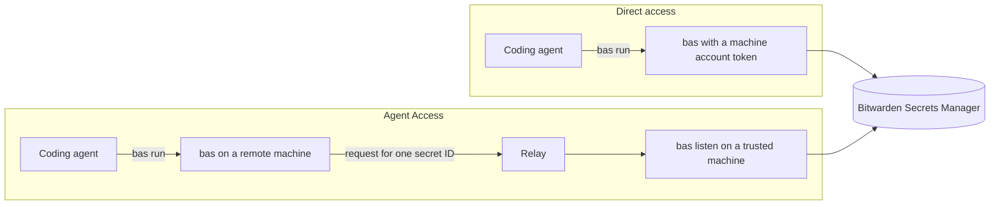
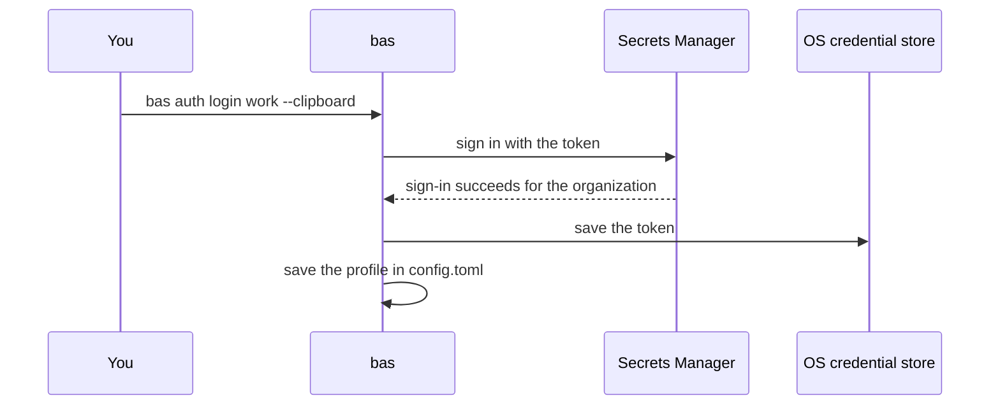
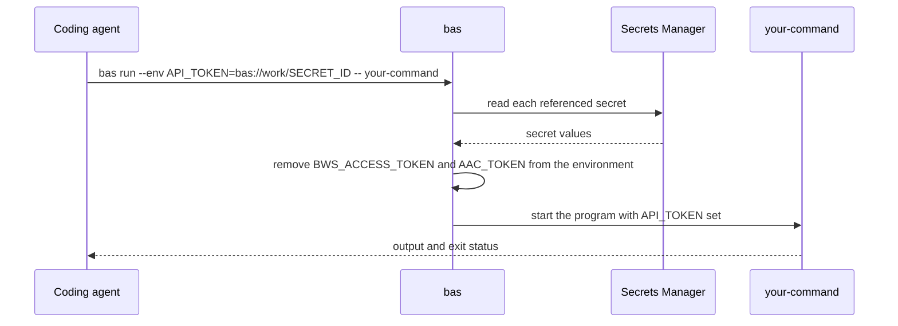
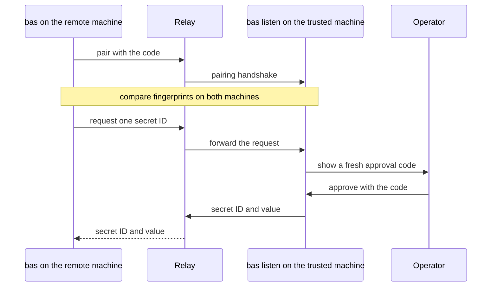
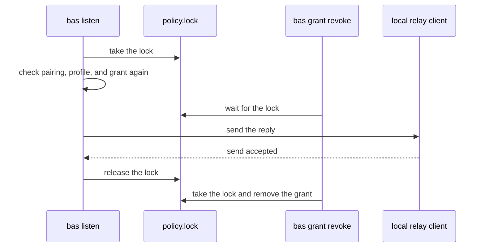

# Bitwarden Agent Secrets

`bas` lets a coding agent find, use, and save secrets in Bitwarden Secrets Manager. The agent handles references of the form `bas://<profile>/<secret-id>` instead of secret values. When the agent asks `bas` to run a program, `bas` puts the matching values into the program's environment. The backend is Bitwarden Secrets Manager, and `bas` doesn't use Bitwarden Password Manager.

`bas` can reach Secrets Manager directly, or it can ask a trusted machine for each secret. With direct access, `bas` holds a machine account token and calls Secrets Manager itself. With Agent Access, a copy of `bas` on a remote machine holds no token, and it asks a listener on a trusted machine for each secret. Agent Access is an experimental Bitwarden protocol that sends credentials between paired machines through a relay server.



## Status

`bas` is unreleased, and it isn't ready for production use. The current checks pass on Linux, macOS, and Windows with the D-Bus credential store. The checks include a build with Rust 1.89, the offline CLI checks, and checks of the extracted release executables. The compatibility check between the earlier zbus credential store and the D-Bus store also passed. The earlier checks of protected storage, pairing, grants, and the live service ran before the switch to the D-Bus store. The dependency update on 2026-11-04 has passed the checks only on Linux x86_64 so far.

The repository has no release license, and the permissions to distribute the Bitwarden SDK still need review. `cargo deny check licenses` also fails, because `deny.toml` doesn't list any allowed licenses. Don't publish packages or binaries on the basis of the README.

The GitHub workflows run only when someone starts them by hand. The `build artifacts` workflow in `release.yml` calls the `ci` workflow in `ci.yml`. No workflow publishes a release, and no workflow receives live vault credentials.

## Install from a release

Each [GitHub release](https://github.com/bjoernaagaard/bitwarden-agent-secrets/releases) publishes `bas-<OS>-<ARCH>.tar.gz` archives built by the `release` workflow on Linux, macOS, and Windows runners. Download the archive for your platform, extract `bas` (or `bas.exe`), and put it on your `PATH`. The archive contains only the executable and this README.

## Build and install

You can build `bas` from a checkout with Rust 1.89 or newer and the native build tools for your platform. The Agent Access crates come from a pinned Git revision, so the first build needs access to the `bitwarden/agent-access` GitHub repository and to crates.io.

```sh
cargo build --locked --release
./target/release/bas --help
./target/release/bas --version
```

On Windows, the executable is `target\release\bas.exe`. Rust 1.89 is the minimum version because grants use the file locks in the standard library. Debug and release builds passed with Rust 1.89 on Linux ARM64, and a debug build passed with Rust 1.89 on Linux x86_64. The minimum toolchain checks on macOS and Windows haven't run yet.

You can run the executable from the build directory without installing it. Before you copy it onto your `PATH`, run `command -v bas` on Unix or `Get-Command bas` in PowerShell. Both commands show whether another program already uses the name `bas`.

```text
on(install bas)
  if command -v bas finds another program
    keep bas in its own directory
    call bas by its full path
    don't overwrite the other program or use a forced Cargo install
  else
    copy target/release/bas onto PATH
```

The CI workflow builds and checks `bas` on the native architecture of each runner. Treat an architecture as supported only after its build and executable checks pass.

## Set up direct access

Direct access starts with a Secrets Manager machine account that can read only the projects you need. A profile in `bas` ties the machine account token to one organization and one endpoint. `bas` saves the profile only after a successful sign-in with the token, organization, and endpoint.

For an EU account, copy the machine account access token to the clipboard and run the commands below.

```sh
bas auth login work --organization <organization-id> --region eu --clipboard
bas auth status work
bas auth list
```



Use `--region us` for the US service. `bas auth login --help` describes custom HTTPS endpoints and input from stdin. Never pass a token as an argument, and never paste a token into an agent transcript.

With clipboard or stdin login, `bas` saves the token in the credential store of the operating system. If the credential store isn't available, the login fails. `bas` never falls back to saving the token in plain text.

For direct use on a machine without a desktop session, supply `BWS_ACCESS_TOKEN` through the protected secret delivery you already use, and log in with `--from-env`. A profile created with `--from-env` reads only the environment variable, and it never falls back to another account.

`bas` keeps its configuration in a `bas` directory inside the user configuration directory. You can set `BAS_CONFIG_DIR` to an absolute path outside every Git repository instead. Keep the directory private, and make sure only trusted users can write to it.

```text
bas/                # or the path in BAS_CONFIG_DIR
├── config.toml     # profiles and paired device fingerprints
├── grants.toml     # grant policy
└── policy.lock     # orders changes to the grant policy
```

Machine tokens and Agent Access keys never go into the configuration directory.

## Find secrets and run a program with them

```sh
bas find --profile work API
bas find --profile work --project <project-id> --json
bas run --env "API_TOKEN=bas://work/<secret-id>" -- your-command
```

`bas find` returns secret IDs and metadata, and it never returns values or notes. Every binding has to resolve before the program starts. `bas` passes the arguments after `--` straight to the program, and it doesn't run them through a shell.



`bas` removes `BWS_ACCESS_TOKEN` and `AAC_TOKEN` from the environment of the program, but it doesn't sandbox the program. The program can print, copy, or send any injected value. It also inherits every other variable in your environment, so pick the command with care.

### Reference templates

A reference template is a file of `NAME=bas://profile/id` bindings, and `bas env run` follows the same rules as `bas run`.

```sh
bas env write .env.refs --env "API_TOKEN=bas://work/<secret-id>"
bas env run .env.refs -- your-command
```

A template can hold bindings, comments, and blank lines. It can't hold plaintext values, shell commands, or substitutions. You need `--force` to replace an existing template. Before you commit a template, decide whether you want its reference metadata in version control.

## Create and update secrets

`bas` reads a new secret value from the clipboard or from piped UTF-8 stdin. It never accepts the value as an argument, and it refuses stdin from a terminal.

```sh
bas create --profile work --key API_TOKEN --project <project-id> --clipboard
bas update bas://work/<secret-id> --clipboard
```

`bas` keeps the input bytes as they are, including any line endings at the end. Machine token parsing handles line endings separately.

An update keeps the key, the note, and the project associations of the secret. The SDK replaces the whole secret without checking for concurrent changes, so an update can overwrite someone else's change. `bas` refuses an update when the SDK would rewrite an existing metadata value into a standard form.

A successful receipt holds metadata and a reference, and it never holds the value. `bas` reads the secret back from Secrets Manager before it reports a verified write. The warning about duplicate names doesn't guarantee that each name is unique.

```text
exit code of bas
  0          the command succeeded, or the write was read back and verified
  1          the command failed before a write, or the write was refused
  2          the usage or the input syntax was invalid
  3          the write was acknowledged but couldn't be verified
  4          the write outcome is unknown
  126, 127   the program couldn't be launched
  otherwise  the exit status of the launched program
```

Don't retry a create or an update automatically when the outcome is unclear. Check the metadata and the service state first. `bas` has no command for deleting a secret.

## Connect a remote machine through a listener

Agent Access is experimental, and both machines need a working credential store for identity keys and session keys. A machine token in the environment doesn't replace the credential store.

Choose and approve a relay before you expose a listener beyond local testing. Use `wss://` for a remote relay, because `bas` accepts plain `ws://` only for loopback addresses. The project doesn't deploy a relay.

On the trusted machine, run the listener.

```sh
bas listen --profile work --relay wss://<relay-host> --allow <secret-id> --pair --peer-name build-host
```

On the remote machine, pair with the listener and run the program.

```sh
bas pair remote --relay wss://<relay-host>
bas run --env "API_TOKEN=bas://remote/<secret-id>" -- your-command
```

Enter the pairing code through the terminal that controls the remote program. Compare the handshake fingerprints on both machines before you confirm. Keep pairing material out of logs and agent transcripts.



Pairing lets a device ask for secrets, and it doesn't give the device access. By default, the operator on the trusted machine approves each exact request with a fresh code that the listener shows in its terminal. `bas` requests each reference separately, and one failed request stops the program from starting.

```text
on(request from a paired device)
  if the secret ID is outside --allow
    deny
  if the grant policy is malformed
    deny
  if an active grant covers the device, profile, and secret ID
    deliver
  else if the listener has a usable terminal
    ask the operator to approve with a fresh code
  else
    deny
```

The listener accepts only explicit secret IDs within its `--allow` list. A remote profile can't find, create, or update secrets, and a remote failure never falls back to a machine token. The listener puts the secret ID in the credential ID field of the Agent Access response and the value in the password field, and it leaves the other fields empty.

The pinned SDK doesn't save replay nonces across a restart, so each delivery has to pass the current authorization checks. A replay nonce is a one-time value that stops an old message from being accepted twice. When a session replacement handshake fails verification, the listener refuses the device and drops any queued replies for it. To recover, restart the listener or pair again, and don't weaken the check.

Paired tests confirmed the refusal during secret retrieval and after an approved reply was queued. The queued reply test used the GDB debugger to control thread scheduling in the unchanged binary. The replacement device received no credential response frame. In a control build with the outbound guard removed, the same test failed.

## Allow delivery without approval, and revoke it

A grant lets the listener deliver a secret without asking the operator. You create grants only on the trusted machine. Each grant ties one paired device fingerprint to a profile, an organization, and exact secret IDs. A grant stays active until you revoke it, and it can't widen the `--allow` list of the listener.

```sh
bas auth list
bas grant add --profile work --device <paired-fingerprint> --secret <secret-id>
bas grant list --profile work --json
bas grant revoke <grant-id>
```

`bas` reuses an identical active grant, and it keeps different overlapping grants separate. To remove access, revoke every grant that allows it. Without a grant, the operator has to approve each request. A malformed policy file makes the listener deny delivery.

The listener checks pairing, profile, and grant state again before it releases an approved reply. The listener holds the shared policy lock until the local relay client returns the send result. As a result, a successful revocation always waits for any delivery that has already started.



The listener withholds a reply that stays queued past its request deadline. It then denies the device until the listener restarts.

Paired tests confirmed revocation during secret retrieval. They also confirmed revocation while the revoke command waited on the policy lock before the relay handoff. The second test paused the unchanged listener with GDB and saw the revoke command waiting in the kernel. After the listener resumed, the test saw the delivery finish and then the revocation complete.

The send result confirms that the local relay client accepted the reply. It doesn't confirm arrival at the remote process. Replies queued before a revocation can still arrive after it. Revocation can't erase a value the remote machine already has.

`bas auth logout <profile>` removes the local credentials and pairing for the profile and revokes its local grants. It doesn't delete any secrets in Secrets Manager.

## Agent instructions and checks

The agent instructions are in [`skills/bitwarden-agent-secrets/SKILL.md`](skills/bitwarden-agent-secrets/SKILL.md). They show an agent how to find references, inject secrets, and write secrets without printing raw values.

The advisory check with `cargo-deny 0.20.2` passes with one exception for `RUSTSEC-2023-0071`, which applies to the RSA crate in the Bitwarden SDK. The exception covers only the advisory ID. The RSA finding stays open, because no patched RSA release exists. Moving the Linux credential store to D-Bus Secret Service removed the unmaintained `zbus_names`, `zvariant`, and `zvariant_derive` dependencies.

Run the local build and the offline CLI checks with the commands below.

```sh
cargo fmt --all -- --check
cargo clippy --locked --all-targets --all-features -- -D warnings
cargo doc --locked --no-deps
cargo build --locked --release --bin bas --example e2e
./target/release/examples/e2e offline --bas "$(pwd)/target/release/bas" --artifacts "$(pwd)/target/e2e/local"
```

The offline end-to-end (E2E) command runs the built executable through reference templates, refused launches, hidden sensitive input, configuration boundaries, and other offline CLI behavior. Each run needs a new artifact directory. The run writes a manifest, case records, the commands, and a summary that is the same on every run.

Earlier external CLI checks and live checks covered more behavior, but they ran before the switch to the D-Bus store.

- Grants
  - Exact grant scope
  - Delivery by grant after a restart
  - Revocation on a running listener
- Writes
  - Reading back a created secret
  - Updating a secret
- Delivery
  - Injection that keeps every byte of the value
  - Approval and denial
  - Protected token storage

Operation across machines and the remaining service failure cases haven't passed release checks yet.

Direct live testing needs a dedicated Secrets Manager project and a working native credential store. Supply the machine token only through the environment of the runner, and never as a command argument or in chat.

```sh
BAS_E2E_ACCESS_TOKEN=... \
BAS_E2E_ORGANIZATION_ID=<organization-id> \
BAS_E2E_PROJECT_ID=<project-id> \
BAS_E2E_REGION=us \
./target/release/examples/e2e live-direct --bas "$(pwd)/target/release/bas" --artifacts "$(pwd)/target/e2e/live-direct"
```

Use `eu` for an EU account.

```text
e2e live-direct
  create a unique profile and a unique secret
  check login, find, run, update, exit codes, and logout
  remove the local profile
  keep the remote secret, because bas can't delete it
```

The report and the Secrets Manager project keep the reference to the remote secret, so you can delete the secret by hand. If a prerequisite is missing, the runner exits with code 3 and records `not_run`. The artifacts never include live command output.
