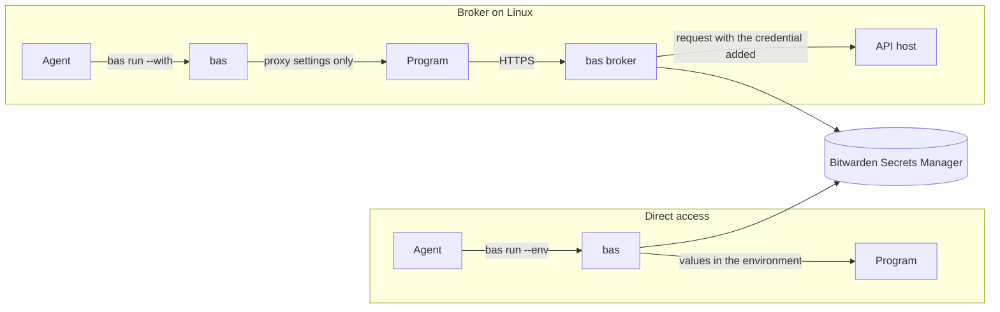

# Bitwarden Agent Secrets

`bas` lets a coding agent use secrets from Bitwarden Secrets Manager through references of the form `bas://<profile>/<secret-id>`, so the values stay out of the agent's commands and transcript. On Linux, the `bas` broker holds the credentials in its policy under a separate system user and adds them to allowed requests, so the programs you run, including agents, get no raw values on a host you have locked down.

The documentation is at <https://snestra.github.io/bas/>.



## Status

`bas` v0.4.0 includes the Linux broker, and it isn't ready for production use. Direct access and Agent Access work on Linux, macOS, and Windows. The broker requires Linux with systemd and an HTTPS address for approvals. Tailscale is optional. The source is under the MIT license.

## Quick start

Download `bas` from the [releases page](https://github.com/Snestra/bas/releases), or build it with `cargo build --locked --release`. Then sign in with a machine account access token, find a reference, and run a program with it.

```sh
bas auth login                                   # paste the token when it asks
bas find --profile default API
bas run --env "API_TOKEN=bas://default/<secret-id>" -- your-command
```

## Documentation

| Page | What it covers |
|---|---|
| [Introduction](https://snestra.github.io/bas/introduction.html) | What `bas` is, and the two ways to use it |
| [Install bas](https://snestra.github.io/bas/getting-started/install.html) | Releases and building from source |
| [Sign in with an access token](https://snestra.github.io/bas/getting-started/first-run.html) | The first run, profiles, and where settings live |
| [Find and use secrets](https://snestra.github.io/bas/getting-started/use-secrets.html) | `bas find`, `bas run`, and reference templates |
| [Create and update secrets](https://snestra.github.io/bas/getting-started/create-and-update.html) | Writes, receipts, and exit codes |
| [How the broker works](https://snestra.github.io/bas/broker/overview.html) | The proxy, the ssh-agent, minted tokens, and approvals |
| [Install the broker](https://snestra.github.io/bas/broker/install.html) | Step by step, with the files in [`contrib/linux/`](contrib/linux) |
| [Lock down the host](https://snestra.github.io/bas/broker/lock-down.html) | What must be true for the broker to keep values from agents |
| [Pair a remote machine with Agent Access](https://snestra.github.io/bas/remote/agent-access.html) | `bas listen`, `bas pair`, and grants |
| [Commands](https://snestra.github.io/bas/reference/commands.html) | Every command and option |

The pages are also in [`docs/src`](docs/src). The agent instructions are in [`skills/bitwarden-agent-secrets/SKILL.md`](skills/bitwarden-agent-secrets/SKILL.md).
