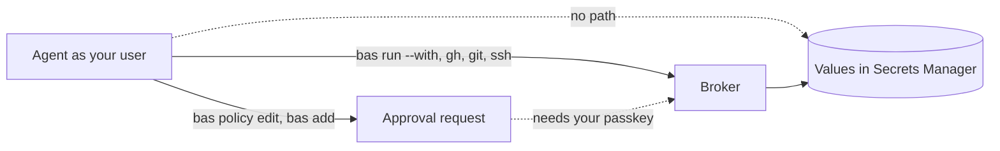

# What an agent can and can't do

An agent that runs as your user on a locked-down broker host can use the credentials the policy allows, and it can't read any of their values. The table assumes that every step of [Lock down the host](lock-down.md) is done and that the old copies of each credential are revoked.

| Credential | Can the agent read the value? | Can the agent use it? |
|---|---|---|
| Secrets Manager machine token | No | No. It can only ask the broker for what the policy allows. |
| API key in a `[secret.NAME]` entry | No | Yes, for the allowed requests to the entry's host |
| GitHub App private key | No | No |
| GitHub installation token, one repository, one hour | No | Yes, for repositories in the policy, with the permissions the policy lists |
| Tailscale OAuth client ID and secret | No | No |
| Tailscale access token | No | Yes, for the requests in `api_allow` |
| SSH key with `use = ["auth"]` | No | Yes, it can log in to hosts that accept the key |
| SSH key with `use = ["sign-git"]` | No | Yes, it can sign git commits and tags |
| Your passkey or YubiKey | No | No. Each approval needs user verification on your device. |
| Credentials that your agent program itself needs to run | Yes | Yes. They are outside bas. |



## What the agent can still do

The agent can do anything the policy allows, as often as it likes, while the broker runs. For example, with a GitHub App that has `contents = "write"`, it can push branches and open pull requests on the listed repositories. Branch protection rules and required reviews on GitHub still apply to the App.

The agent can also ask for changes. It can run `bas policy edit`, `bas add`, or `bas rotate`, and the request waits for your passkey. Read each diff on the approval page before you approve the request. The page shows the change and the process ID and user ID of the process that asked.

The agent can deny a pending request, because denying needs no passkey. A denial grants nothing, so the worst case is that you have to ask again.

## What can leak a value anyway

The broker never sends a value to a program, but a host that receives the value can send it back. The proxy doesn't inspect responses. If a policy entry allows a request whose response repeats the request headers, the program reads the credential in the response. Allow only the methods and paths a program needs, and never allow a path that echoes headers, such as `GET /headers` on httpbin.org.

```text
on(choose allow patterns)
  list the exact endpoints the program calls
  if an endpoint returns your request headers or the key itself
    leave it out
  prefer "POST /v1/embeddings" over "POST /v1/*"
```
