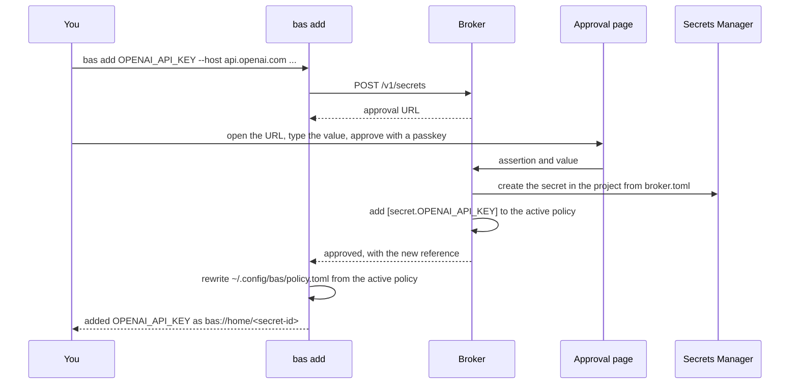

# Daily use

On a broker host, you and your agents use five commands. `bas run --with` uses a credential, and `bas add`, `bas rotate`, and `bas policy edit` change what the broker holds, after you approve with a passkey. `bas audit` shows what happened.

| Command | Needs an approval | What it does |
|---|---|---|
| `bas run --with NAME -- CMD` | No | Runs `CMD` with proxy settings for the policy entry `NAME` |
| `bas add NAME --host H --allow "METHOD /path"` | Yes | Creates a secret and a `[secret.NAME]` entry, with a value you type on the approval page |
| `bas rotate NAME` | Yes for a stored value, no for `github` and `tailscale` | Replaces a stored value, or drops minted tokens |
| `bas policy edit` | Yes | Sends your edited policy proposal |
| `bas audit` | No | Prints the broker's journal entries |

## Use a credential with bas run --with

`bas run --with NAME` asks the broker whether `NAME` is a `[secret.NAME]` entry, `github`, or `tailscale` in the active policy, and then starts the program with proxy settings. The program's HTTPS requests go through the proxy, which adds the credential for the entry's host. The program never receives the value.

```sh
bas run --with JINA_API_KEY -- curl -s https://api.jina.ai/v1/embeddings -H 'content-type: application/json' -d @request.json
bas run --with JINA_API_KEY --with tailscale -- ./script.sh
```

`bas run --with` sets the variables below in the program's environment:

```text
HTTPS_PROXY=http://127.0.0.1:3128
https_proxy=http://127.0.0.1:3128
SSL_CERT_FILE=/run/bas/ca-bundle.pem
CURL_CA_BUNDLE=/run/bas/ca-bundle.pem
REQUESTS_CA_BUNDLE=/run/bas/ca-bundle.pem
NODE_EXTRA_CA_CERTS=/run/bas/ca-bundle.pem
GIT_SSL_CAINFO=/run/bas/ca-bundle.pem
```

Most HTTPS clients read one of the variables, e.g. curl, git, Python `requests`, and Node.js with `NODE_USE_ENV_PROXY=1`. A program that ignores proxy variables reaches the host directly, without the credential, and the host refuses it.

If a name isn't in the active policy, the program doesn't start.

```text
$ bas run --with NOPE -- true
bas: not started: the bas broker denied NOPE: it is not a proxy entry of the active policy
```

`bas run --env NAME=bas://...` still works on a broker host, but it needs a direct profile with its own machine token, and it puts the value in the program's environment. A locked-down broker host has no such profile.

## Add a new API key

`bas add` creates a secret and its policy entry in one approval. You type the value on the approval page, so the value never passes through a terminal on the broker host.

```sh
bas add OPENAI_API_KEY --host api.openai.com --allow "POST /v1/*" --allow "GET /v1/models"
```



`--header` defaults to `Authorization`, and `--value` defaults to `Bearer {secret}`. For an API that wants another header, set both, as in `--header x-api-key --value "{secret}"`. `NAME` must be a valid environment variable name, and it becomes the key of the new secret. Each host can belong to one entry only.

## Rotate a credential

`bas rotate NAME` replaces the value of a `[secret.NAME]` entry. Create the new key at the provider first, then run the command, open the approval page, type the new value, and approve. The broker updates the secret in Secrets Manager.

```sh
bas rotate OPENAI_API_KEY
bas rotate github
bas rotate tailscale
```

`bas rotate github` and `bas rotate tailscale` need no approval. They drop the broker's cached tokens, and the next request mints new ones. Revoke the old key at the provider after the rotation.

To replace an SSH key, change the secret in Secrets Manager, then restart the broker with `sudo systemctl restart bas-broker`. The broker loads SSH keys when it starts and when a policy change is approved.

## Change the policy

`bas policy edit` opens your proposal, `~/.config/bas/policy.toml`, in `$VISUAL` or `$EDITOR`. After you save and quit, it sends the proposal, prints the diff and the approval URL, and waits. After the approval, it rewrites your proposal from the active policy.

```text
bas policy edit
├── no proposal yet: copy the active policy to ~/.config/bas/policy.toml
├── open the proposal in the editor
├── send it to the broker
│   ├── the same as the active policy: print "nothing to approve" and stop
│   ├── invalid: print the error with its line number and stop
│   └── otherwise: print the diff and the approval URL
└── wait for the approval, then rewrite the proposal from the active policy
```

If the active policy changes while a proposal waits for approval, for example because of a `bas add`, the approval fails with "the active policy changed after this request", so one change can't silently undo another. Run `bas policy edit` again. If you sync `~/.config/bas/policy.toml` to other machines, each broker asks for its own approval.

## Add a passkey

`bas passkey add` asks an enrolled passkey to approve one more. After you approve, the approval page shows a one-time enrollment link, valid for 15 minutes. Open it on the device that should hold the new passkey. The link never appears in the terminal.

## Read the audit log

`bas audit` reads the broker's entries from the system journal. Reading the system journal needs membership in the `adm` or `systemd-journal` group.

```sh
bas audit --since 1h
bas audit --name JINA_API_KEY --since 2d
bas audit --json --since 30m
```

| Event | Written when |
|---|---|
| `run` | `bas run --with` got proxy settings |
| `inject` | the proxy added a credential to a request |
| `mint` | the broker minted a GitHub or Tailscale token |
| `sign` | the ssh-agent made a signature |
| `request` | a command asked for an approval |
| `approve` | a passkey approved a request |
| `policy` | a new policy became active |
| `rotate` | `bas rotate` dropped minted tokens |
| `enroll` | a passkey was enrolled |
| `deny` | the broker refused a caller, a name, a request, or an approval |

`--unit` or `BAS_BROKER_UNIT` reads another unit, such as a test unit called `bas-broker-dev`.
