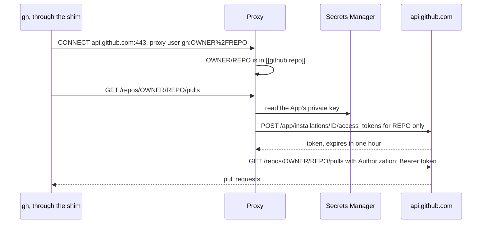

# Set up a GitHub App

A GitHub App lets the broker mint a token for one repository at a time, valid for one hour, instead of keeping a personal token that reaches every repository you can. The broker holds the App's private key, and the proxy adds the minted token to requests for `api.github.com`, `uploads.github.com`, and `github.com`. `gh` and git over HTTPS then work without any token on your side.



## Create the App

Open the prefilled creation page below in a browser where you are signed in to GitHub. Replace `ORG` with your organization and `NAME` with a name for the App, such as `bas-homelab`. The parameters turn off webhooks and ask for the permissions the broker's example policy uses.

```text
https://github.com/organizations/ORG/settings/apps/new?name=NAME&url=https://github.com/ORG&webhook_active=false&contents=write&pull_requests=write&issues=write&actions=read&metadata=read
```

For an App owned by your personal account, use `https://github.com/settings/apps/new?` with the same parameters. Check the permissions on the page, choose that the App can be installed only on your account, and create it. Note the App ID at the top of the App's settings page.

Leave out the `workflows` permission. Without it, a token can't change files under `.github/workflows`, so an agent can't change what your CI runs or what it publishes.

## Store the private key

On the App's settings page, generate a private key. GitHub downloads a `.pem` file. Create a new secret in the broker's project in the Secrets Manager web vault, paste the whole contents of the file as the value, and note the secret's ID. Then delete the file.

```sh
shred -u ~/Downloads/NAME.*.private-key.pem
```

## Install the App on repositories

On the App's page, choose Install App, pick the account, and select the repositories the broker may mint tokens for. After the install, the browser shows a URL that ends in the installation ID.

```text
https://github.com/organizations/ORG/settings/installations/7654321
                                                            └─ installation_id
```

## Add the App to the policy

Run `bas policy edit` and add a `[github]` table and one `[[github.repo]]` entry for each repository. Each token asks for the permissions you list for its repository, which must be within the App's permissions.

```toml
[github]
app_id = 123456
private_key = "bas://home/<secret-id>"

[[github.repo]]
name = "OWNER/REPO"
installation_id = 7654321
permissions = { contents = "write", pull_requests = "write", issues = "write", actions = "read" }
```

Approve the change with your passkey. Then check that `gh` works from a checkout of the repository.

```sh
cd ~/src/REPO
gh api repos/OWNER/REPO --jq .full_name
bas audit --since 5m
```

```text
OWNER/REPO
2026-11-10T22:38:56Z  mint     minted a github token for OWNER/REPO, valid until 2026-11-10T23:38:56Z
2026-11-10T22:38:56Z  inject   added github:OWNER/REPO to GET https://api.github.com/repos/OWNER/REPO
```

## How the proxy picks the repository

Each token covers one repository, so the proxy must know which repository a request is for. It reads the repository from the request path when the path names one, and otherwise from the proxy user that the `gh` shim sets. When both name a repository, they must match.

```text
on(request to a GitHub host)
  if host is github.com
    allow only git over HTTPS: /OWNER/REPO.git/info/refs, git-upload-pack, git-receive-pack, info/lfs/
    repository = OWNER/REPO from the path
  else if path starts with /repos/OWNER/REPO
    repository = OWNER/REPO from the path
  else
    repository = OWNER/REPO from the proxy user gh:OWNER%2FREPO
  if repository isn't in [[github.repo]]
    refuse with 403
  add a token for the one repository only
```

When a request path names no repository, the proxy uses the repository that the `gh` shim names for the current directory, and without either one it refuses the request. Endpoints that need a user token, such as `gh api user`, fail, because GitHub refuses installation tokens there. Commands that need your own account, such as creating a gist or a repository under your name, don't work through the broker.

## git over HTTPS

git over SSH uses the broker's ssh-agent and an `[ssh.NAME]` key, as [Install the broker](install.md) sets up. To use the App for git over HTTPS instead, run git through the proxy.

```sh
bas run --with github -- git push https://github.com/OWNER/REPO HEAD:my-branch
```

```text
$ bas run --with github -- git ls-remote https://github.com/OWNER/REPO HEAD
<commit>	HEAD
$ bas audit --since 1m
...  inject   added github:OWNER/REPO to GET https://github.com/OWNER/REPO/info/refs
...  inject   added github:OWNER/REPO to POST https://github.com/OWNER/REPO/git-upload-pack
```

Pushes and pull requests made with an App token show the App's bot as the actor. Commits keep the author name and email from your git settings.

## When something fails

| Message | Cause |
|---|---|
| `bas broker: could not mint a GitHub token for OWNER/REPO: could not read the App's private key` | The `private_key` reference is wrong, or the broker's machine account can't read it |
| `bas broker: could not mint a GitHub token for OWNER/REPO: [github] private_key is not an RSA private key in PEM` | The secret doesn't hold the whole `.pem` file |
| `bas broker: could not mint a GitHub token for OWNER/REPO: GitHub refused: ...` | The App isn't installed on the repository, the installation ID is wrong, or the policy asks for a permission the App lacks |
| `the bas policy has no [[github.repo]] entry for OWNER/REPO` or `refused by bas policy: repository not in [github]` | Add the repository to the policy |
| `refused by bas policy: no repository: put it in the path or in the proxy user, as gh:OWNER%2FREPO` | Run `gh` inside a checkout whose `origin` is on GitHub, or name the repository in the path |
| `the active policy has no [github] table, so the bas broker cannot mint GitHub tokens` | Add the `[github]` table |

After you change the App's permissions or the installation, run `bas rotate github` so the broker drops its cached tokens and mints new ones on the next request.
