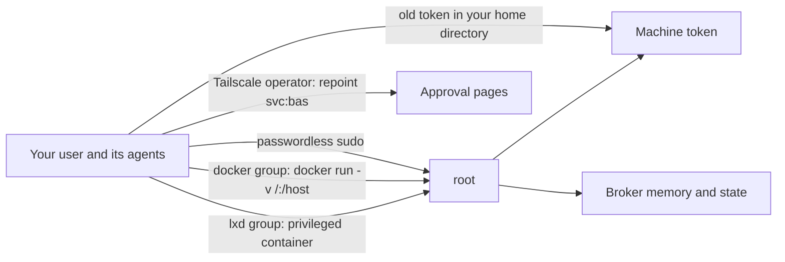

# Lock down the host

The broker keeps values away from your user only while your user can't become root. Root can read the sealed token's key, the broker's memory, and its state directory, so any path from your user to root is a path to every credential. Agents run as your user, so close each path before you rely on the broker.



Each step below closes one of the arrows in the diagram.

## Make sudo ask for a password

Remove any `NOPASSWD` rule for your user from `/etc/sudoers` and `/etc/sudoers.d/`, and make sure your user has a password. Edit the files with `visudo` so a syntax error can't lock you out, and keep a root shell open until `sudo` works again in a new terminal.

```diff
 # /etc/sudoers.d/USER
-USER ALL=(ALL) NOPASSWD: ALL
+USER ALL=(ALL) ALL
```

```text
$ sudo -n true
sudo: interactive authentication is required
```

A sudo password still has a weak point. An agent that runs as your user can change your shell startup files, so it could wrap `sudo` and capture the password the next time you type it. Don't type the sudo password in a terminal that an agent could have set up, and prefer root over Tailscale SSH for admin work.

## Leave the docker and lxd groups

Membership in the `docker` or `lxd` group gives root, because a member can start a container that mounts the host's file system. Remove your user from both, then log out and back in.

```sh
sudo gpasswd -d "$USER" docker
sudo gpasswd -d "$USER" lxd
id
```

To use containers as your user afterwards, use rootless Docker or Podman.

## Reach root over Tailscale SSH in check mode

Tailscale SSH in check mode asks you to sign in to Tailscale again in a browser before it opens a root session, and an agent on the host can't do that sign-in. Turn on Tailscale SSH on the host, and add an SSH rule for `root` with `"action": "check"` to the tailnet policy file in the admin console.

```sh
sudo tailscale set --ssh
```

```json
"ssh": [
  {
    "action": "check",
    "src": ["autogroup:member"],
    "dst": ["tag:server"],
    "users": ["root"],
    "checkPeriod": "12h"
  }
]
```

Set `dst` to the tag or host of the broker machine. Test `ssh root@HOST` from another device twice before you remove any other way to root.

## Stop your user from repointing the approval pages

A Tailscale operator is a user who may change `tailscale serve` without sudo. If your user is the operator, an agent could point `svc:bas` at a page of its own and show you a false request to approve. Clear the operator setting.

```sh
tailscale debug prefs | grep OperatorUser
sudo tailscale set --operator=
```

Afterwards, every `tailscale serve` change needs root.

## Delete the old user-scope token

Before the broker, the machine token may have lived in your home directory, for example in a file sealed with `systemd-creds --user`, in `BWS_ACCESS_TOKEN` set by a shell function or a mise environment file, or in a direct `bas` profile. Your user can decrypt a user-scope credential, so an agent can too. Remove every copy, and revoke the old token in the web vault.

```sh
bas auth list
bas auth logout home                   # a direct profile and its stored token
rm -f ~/.local/share/bas/bws.cred      # a token sealed with systemd-creds --user
rg -n 'BWS_ACCESS_TOKEN|bws.cred' ~/.zshenv ~/.zshrc ~/.bashrc ~/.profile ~/.config/mise
```

In the web vault, open the machine account under Secrets Manager, then Machine accounts, and revoke the old access token on its Access tokens tab. The broker's token is a separate access token that only the sealed credential holds.

## Revoke the other old credentials

Moving a credential into the broker protects it only if the old copy stops working. Revoke each old credential at its issuer and delete the local file.

| Old credential | Revoke at | Delete |
|---|---|---|
| `gh` OAuth token | GitHub, Settings, Applications, Authorized OAuth Apps, GitHub CLI | `~/.config/gh/hosts.yml` |
| SSH private keys | GitHub, Settings, SSH and GPG keys, and every `authorized_keys` that lists them | `~/.ssh/id_*`, keep the `.pub` files |
| API keys in dotfiles or the environment | Each provider's console | The lines that set them |
| Tailscale OAuth clients and API keys | Tailscale admin console, Trust credentials or Keys | The lines that set them |

## Check the result

Run the checks below as your own user. Each must fail.

```text
check as your user                                         expected
sudo -n true                                               interactive authentication is required
docker ps                                                  permission denied
cat /etc/credstore.encrypted/bas-bws.cred                  permission denied
systemd-creds decrypt /etc/credstore.encrypted/bas-bws.cred -    fails
cat /proc/$(pgrep -u bas -f 'bas broker')/environ          permission denied
ls /var/lib/bas                                            permission denied
printenv | grep -E 'BWS_ACCESS_TOKEN|GH_TOKEN|_API_KEY'    no output
```

The credentials that your agent program itself needs to run, such as its login to a model provider, are outside bas, and the agent can read them. [What an agent can and can't do](agent-limits.md) lists every case.
