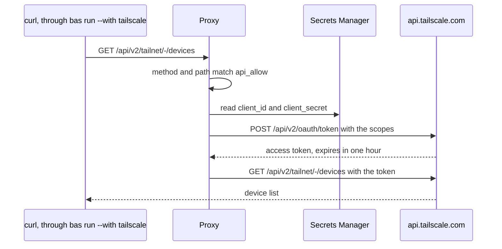

# Set up a Tailscale OAuth client

A Tailscale OAuth client lets the broker mint short-lived access tokens for the Tailscale API. The broker keeps the client ID and the client secret, and the proxy adds a token to requests for `api.tailscale.com` whose method and path match `api_allow`. A program never sees the client secret or the token.



## Create the client

In the Tailscale admin console, open Trust credentials and create an OAuth credential. Choose only the scopes you need. For example, the Read permission under Devices, then Core, gives the scope `devices:core:read`. After you generate the credential, the console shows the client ID and the client secret once.

Store both in the broker's project in the Secrets Manager web vault, as two secrets, and note their IDs. Close the console page without saving the values anywhere else.

## Add the client to the policy

Run `bas policy edit` and add a `[tailscale]` table. `scopes` must be within the scopes of the client, and `api_allow` lists the requests the proxy lets through.

```toml
[tailscale]
client_id = "bas://home/<secret-id>"
client_secret = "bas://home/<secret-id>"
scopes = ["devices:core:read"]
api_allow = ["GET /api/v2/tailnet/-/devices"]
```

Approve the change, and then call the API through the proxy.

```sh
bas run --with tailscale -- curl -s https://api.tailscale.com/api/v2/tailnet/-/devices | jq '.devices | length'
bas run --with tailscale -- curl -s https://api.tailscale.com/api/v2/tailnet/-/keys
```

```text
7
refused by bas policy: method and path not in api_allow
```

The second request isn't in `api_allow`, so the proxy refuses it and writes a `deny` entry to the journal.

## Wider access

Each new API path needs a scope on the client and an entry in `api_allow`. For example, managing the tailnet policy file and Tailscale Services needs more scopes and paths.

```diff
 [tailscale]
-scopes = ["devices:core:read"]
-api_allow = ["GET /api/v2/tailnet/-/devices"]
+scopes = ["devices:core:read", "policy_file", "services"]
+api_allow = [
+  "GET /api/v2/tailnet/-/devices",
+  "GET /api/v2/tailnet/-/acl",
+  "POST /api/v2/tailnet/-/acl",
+  "POST /api/v2/tailnet/-/acl/validate",
+  "GET /api/v2/tailnet/-/services",
+  "GET /api/v2/tailnet/-/services/*",
+  "PUT /api/v2/tailnet/-/services/*",
+]
```

An entry such as `POST /api/v2/tailnet/-/acl` lets an agent change who can reach what on your tailnet, so add it only if you want an agent to do that.

After you change the client's scopes in the admin console, run `bas rotate tailscale` so the broker drops its cached token.

The broker covers the Tailscale API only. The `tailscale` command on the machine talks to the local `tailscaled`, and the broker doesn't change who may run it.
