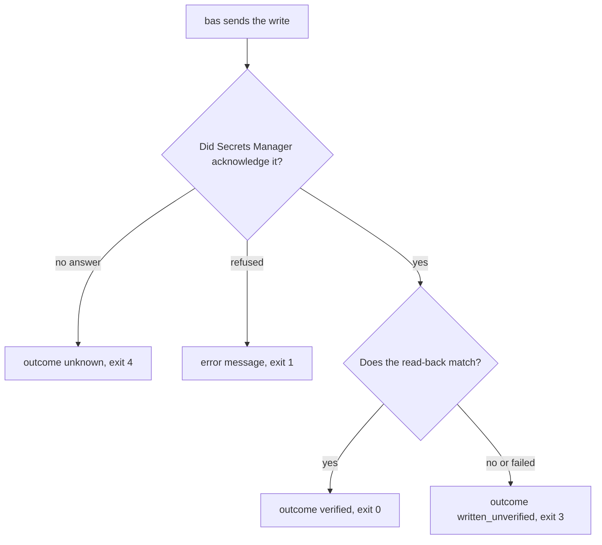

# Create and update secrets

`bas create` and `bas update` write a secret value that they read from the clipboard or from piped stdin. They never accept a value as an argument, and they refuse stdin from a terminal, because typed text would show on the screen.

```sh
bas create --profile work --key API_TOKEN --project <project-id> --clipboard
bas update bas://work/<secret-id> --clipboard
some-tool print-token | bas update bas://work/<secret-id> --stdin
```

`bas` keeps the input bytes as they are, including any line endings at the end.

## What an update keeps

An update replaces the value and keeps the key, the note, and the project of the secret. The Bitwarden SDK replaces the whole secret without checking for changes made by someone else in the meantime, so an update can overwrite another person's change. `bas` refuses an update when the key or the note starts or ends with whitespace, because the SDK would trim it. Update such a secret in the web vault instead.

```diff
 secret <secret-id>
   key      API_TOKEN
   note     rotated by hand on 2026-11-01
   project  <project-id>
-  value    old value
+  value    new value
```

## Receipts and verification

After a write, `bas` reads the secret back from Secrets Manager and prints a JSON receipt. The receipt holds metadata and the reference, and never the value. Its `outcome` field says what `bas` could confirm, and the exit code says the same.



Don't retry a create or an update automatically when the outcome is unclear. Check the secret in the web vault first. `bas` has no command that deletes a secret, and the terminal UI (`bas tui`) can delete one after you type its key.

## Exit codes

Every `bas` command uses the same exit codes. `bas run` and `bas env run` pass on the exit status of the program they started.

```text
exit code of bas
  0          the command succeeded, or the write was read back and verified
  1          the command failed before a write, or the write was refused
  2          the usage or the input syntax was invalid
  3          the write was acknowledged but couldn't be verified
  4          the write outcome is unknown
  126, 127   the program couldn't be launched
  otherwise  the exit status of the launched program
```

[Exit codes](../reference/exit-codes.md) has the same table, with what to do after each code.
