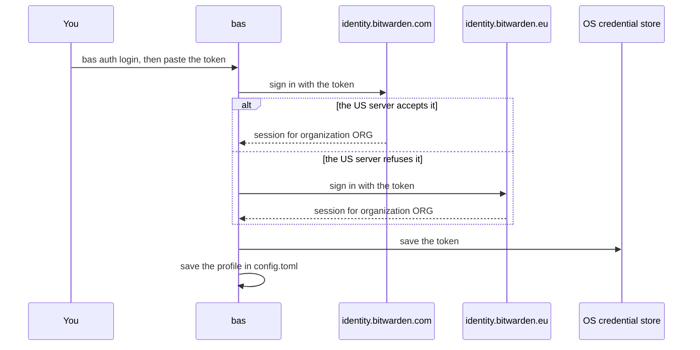

# Sign in with an access token

The first run needs one thing, the access token of a Secrets Manager machine account. A machine account is a Secrets Manager identity for programs, and you give it access to the projects it may read or write. Create one in the Bitwarden web vault under Secrets Manager, then Machine accounts, and create an access token on its Access tokens tab.

## Sign in

Run `bas auth login` in a terminal and paste the token when it asks. `bas` hides what you paste, and it saves the profile only after Secrets Manager accepts the token.

```sh
bas auth login           # paste the token, then press Enter
bas auth status default  # signs in again and reports the organization and endpoint
```

`bas` learns the rest by itself. The token holds an ID, a client secret, and a key, and it names no organization and no server. `bas` asks bitwarden.com first, and if that server refuses the token, it asks bitwarden.eu. The server that accepts the token names the organization in its answer. The profile is called `default` unless you give a name, as in `bas auth login work`.



`bas tui` does the same sign-in on its first screen when no profile exists yet, and then it shows your projects and secrets.

## Pin the answer with flags

You can name the organization, the region, or the server yourself. `bas` still refuses a token of another organization.

| Flag | What it does |
|---|---|
| `--organization <UUID>` | Requires the token to belong to the organization |
| `--region us` or `--region eu` | Uses bitwarden.com or bitwarden.eu only |
| `--server-url <URL>` | Uses a self-hosted server at `URL/api` and `URL/identity` |
| `--api-url <URL> --identity-url <URL>` | Uses two explicit endpoints |
| `--clipboard` | Reads the token from the clipboard |
| `--stdin` | Reads the token from piped stdin |
| `--from-env` | Stores nothing and reads `BWS_ACCESS_TOKEN` at every use |

Never pass a token as an argument, and never paste a token into an agent transcript. With a pasted, clipboard, or stdin token, `bas` saves the token in the credential store of the operating system. If no credential store is available, the sign-in fails, and `bas` never falls back to a plain text file.

On a server without a desktop session, have your existing secret delivery set `BWS_ACCESS_TOKEN`, and sign in with `bas auth login --from-env`. A profile created with `--from-env` reads only `BWS_ACCESS_TOKEN` at each use.

## Where bas keeps its settings

`bas` keeps profiles in a `bas` directory inside the user configuration directory, which is `~/.config/bas` on Linux. You can set `BAS_CONFIG_DIR` to another absolute path outside every Git repository. The directory must be private to its owner, and `bas` refuses a group-readable one.

```text
~/.config/bas/       # or the path in BAS_CONFIG_DIR, mode 0700
├── config.toml      # profiles and paired device fingerprints
├── grants.toml      # grants for paired devices
├── policy.lock      # orders changes to grants and profiles
└── policy.toml      # broker policy proposal, on a broker host only
```

Machine tokens and Agent Access keys never go into the configuration directory.

## Check readiness

`bas doctor` reports what is set up without contacting a server. With `--profile`, it also signs in and confirms the organization.

```sh
bas doctor
bas doctor --profile default
```

If a step fails, [First-run messages](../reference/first-run.md) lists every message `bas` can print before the first secret, what it most likely means, and the command to type next.
