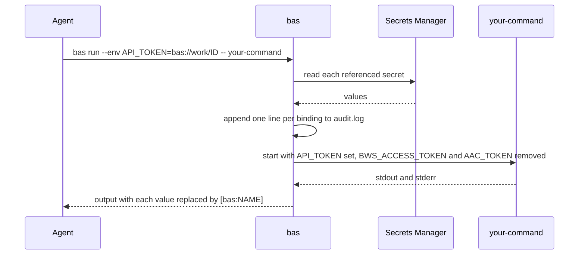

# Find and use secrets

An agent finds a secret by its key, gets a reference back, and passes the reference to `bas run`. The value never appears in the agent's commands or in its transcript.

## Find a reference

`bas find` lists the secrets whose key contains a fragment you give, and it prints each one's reference. It never prints values or notes.

```sh
bas find --profile work API
bas find --profile work --project <project-id> --json
```

```text
$ bas find --profile work --json API
{"matches":[{"reference":"bas://work/<secret-id>","key":"API_TOKEN","project_ids":["<project-id>"],"matched":["API"],"duplicate_key":false}],"unmatched":[]}
```

The search ignores case. Without a fragment, `bas find` lists every secret the machine account can read. A fragment that matches nothing appears under `unmatched`.

## Run a program with secrets

`bas run` reads every referenced secret, puts each value in the variable you name, and starts the program. If any reference fails, the program doesn't start.

```sh
bas run --env "API_TOKEN=bas://work/<secret-id>" -- your-command --flag
```



`bas run` follows the rules below:

- It passes the arguments after `--` straight to the program, without a shell.
- It removes `BWS_ACCESS_TOKEN` and `AAC_TOKEN` from the program's environment. The program inherits every other variable in your environment.
- It replaces each injected value of 4 or more bytes with `[bas:NAME]` in the program's stdout and stderr.
- Before the program starts, it appends one JSON line per binding to `audit.log`. A line holds the time, the variable name, the reference, the program name, the working directory, and the process ID, and never a value. If `bas` can't write the line, the program doesn't start.

```text
$ bas run --env "API_TOKEN=bas://work/<secret-id>" -- sh -c 'echo "$API_TOKEN"'
[bas:API_TOKEN]
```

Masking guards against accidents in a transcript, and it doesn't sandbox the program. The program can still write a value to a file, send it over the network, or print it in another encoding, such as base64. Pick the program with care. To keep values away from an agent on purpose, use [the broker](../broker/overview.md).

## Give one secret to a credential helper

Some tools run a command and read one secret from its stdout, such as pi's `"!cmd"` keys in `auth.json`, git credential helpers, and `apiKeyHelper`. `bas run` masks stdout, so it can't serve them. `bas get` prints the raw value with no trailing newline, but only for a reference you allowed.

```sh
bas helper allow bas://work/<secret-id>   # asks you to type a one-time code
bas helper list
bas helper revoke bas://work/<secret-id>
```

```json
"managementKey": "!bas get bas://work/<secret-id>"
```

`bas get` follows the rules below:

- It refuses a reference that isn't on the list, and other references stay masked as before.
- It refuses when stdout is a terminal, so the value never shows on screen.
- Before it prints, it appends one JSON line to `audit.log` with the reference, the parent process, and the working directory, and never the value. If `bas` can't write the line, it prints nothing.
- A reference of a remote profile still needs approval or a grant on the listener.

## Keep bindings in a template

A reference template is a file of `NAME=bas://profile/id` lines. `bas env run` reads a template and then follows the same rules as `bas run`.

```sh
bas env write .env.refs --env "API_TOKEN=bas://work/<secret-id>" --env "DB_URL=bas://work/<secret-id>"
bas env run .env.refs -- your-command
```

```text
# .env.refs
API_TOKEN=bas://work/<secret-id>
DB_URL=bas://work/<secret-id>
```

A template holds bindings, comments, and blank lines only. It can't hold plain text values, shell commands, or substitutions, and `bas` expands nothing in it. `bas env write` refuses to replace an existing file unless you add `--force`. A template holds no secret, but before you commit one, decide whether you want its secret IDs in version control.
