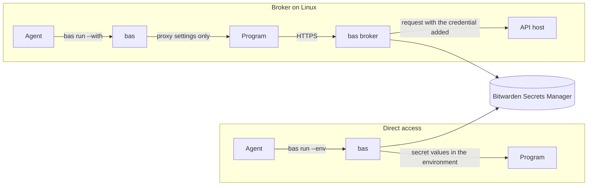

# Introduction

`bas` lets a coding agent use secrets from Bitwarden Secrets Manager without printing them. The agent works with references of the form `bas://<profile>/<secret-id>`, and `bas` puts the matching values into the environment of the program the agent runs. `bas` uses Bitwarden Secrets Manager only, and it doesn't use Bitwarden Password Manager.

`bas` is for a person who runs coding agents on their own machines and keeps API keys, SSH keys, and service tokens in Secrets Manager. It is at version 0.8.3, and it isn't ready for production use.

## Two ways to use bas

You can use `bas` directly, or you can run the `bas` broker on a Linux machine. With direct access, `bas run` reads each referenced secret and starts the program with the values in its environment. The program, and any agent that controls it, can read the values. With the broker, a separate system user holds every credential, and the program gets only proxy settings, an ssh-agent socket, and short-lived tokens that the broker adds to its requests. On a host you have locked down, as [Lock down the host](broker/lock-down.md) describes, no program you run can read a raw value, as long as the policy hosts don't send credentials back in their responses.



| Question | Direct access | Broker |
|---|---|---|
| Where does the machine token live? | In your OS credential store, or in `BWS_ACCESS_TOKEN` | Sealed for one systemd service that runs as its own user |
| Can the program read the value? | Yes | No |
| Which platforms? | Linux, macOS, and Windows | Linux with systemd |
| Who approves a new secret? | Nobody. The machine account's project access decides. | You, with a passkey or a YubiKey |

A third way, Agent Access, lets a remote machine that holds no token ask a trusted machine for each secret. It is experimental, and [Pair a remote machine with Agent Access](remote/agent-access.md) describes it.

## Where to start

Start with [Install bas](getting-started/install.md) and [Sign in with an access token](getting-started/first-run.md). On a Linux machine where agents run unattended, go on to [How the broker works](broker/overview.md).

```text
docs
├── Getting started       install, sign in, find, run, create, update
├── The credential broker install and daily use on Linux
├── Remote machines       Agent Access and grants
├── Other platforms       macOS and Windows
└── Reference             commands, exit codes, files, variables, security
```
