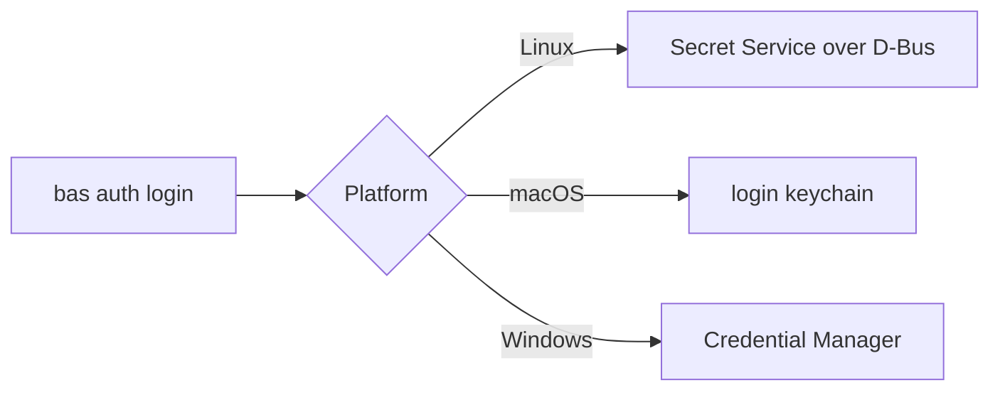

# macOS and Windows

On macOS and Windows, `bas` works with direct access and Agent Access, and the broker isn't available. The broker needs systemd, a separate system user, and Linux peer credentials on Unix sockets, so it is built for Linux only.

| Feature | Linux | macOS | Windows |
|---|---|---|---|
| `bas auth`, `find`, `run --env`, `env`, `create`, `update`, `tui`, `doctor` | yes | yes | yes |
| `bas listen`, `pair`, `grant` (Agent Access) | yes | yes | yes |
| `bas broker`, `add`, `rotate`, `policy`, `audit`, `passkey` | yes | no | no |
| `bas run --with` | yes | no | no |

```text
bas --help on macOS and Windows
  auth, find, run, env, create, update, doctor, listen, pair, grant, tui
  (no broker, add, rotate, policy, audit, or passkey)
```

## Where the token lives

`bas auth login` saves the machine token in the credential store of the operating system. On macOS, the store is the login keychain, and a locked keychain makes the sign-in fail with a message that names it. Run `security unlock-keychain` and try again. On Windows, the store is the Windows Credential Manager.



## What direct access protects

With direct access, `bas run` puts each value in the program's environment, so an agent that controls the program can read the value. Masking hides values in the program's output, and it doesn't stop a program that wants the value. Use a machine account that can read only the projects an agent needs, and keep high-value credentials on a Linux broker host instead.
