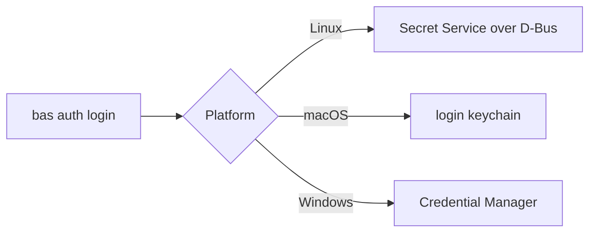

# macOS and Windows

On macOS and Windows, `bas` works with direct access and Agent Access. The broker runs on Linux and macOS, and not on Windows.

| Feature | Linux | macOS | Windows |
|---|---|---|---|
| `bas auth`, `find`, `run --env`, `env`, `create`, `update`, `tui`, `doctor` | yes | yes | yes |
| `bas listen`, `pair`, `grant` (Agent Access) | yes | yes | yes |
| `bas broker`, `add`, `rotate`, `policy`, `audit`, `passkey` | yes | yes | no |
| `bas run --with`, `bas tui --broker` | yes | yes | no |

```text
bas --help on Windows
  auth, find, run, env, create, update, doctor, listen, pair, grant, tui
  (no broker, add, rotate, policy, audit, or passkey)
```

## The broker on macOS

The macOS broker serves the same socket API, proxy, ssh-agent, and approval pages as the Linux broker. These parts differ, because macOS has no systemd and no journal.

| Part | Linux | macOS |
|---|---|---|
| Service | systemd unit, user `bas` | LaunchDaemon, role account `_bas` |
| Machine token | sealed with `systemd-creds` | the file `/var/db/bas/credentials/bws`, readable only by `_bas` |
| Audit record | the system journal | `/var/log/bas/audit.jsonl`, append-only, read through the broker |
| Approval pages | `127.0.0.1:793` | the socket `/var/run/bas/approve.sock`, published with `tailscale serve` |
| Sandbox | systemd's `Protect*` options | none; the separate user is the only wall |

Three limits hold on macOS:

- The broker keeps values from your user only while your user isn't an administrator. An admin's password is worth root, and an agent that runs as you can capture it or wait for a Touch ID or security key touch at a `sudo` prompt. Make your daily account a standard user, as [Install the broker](broker/install.md#install-on-macos) describes.
- Go programs on macOS, `gh` among them, ignore `SSL_CERT_FILE`, so they can't use the proxy. The macOS install ships no `gh` shim.
- No firewall rule limits the proxy port to your user. Any local account can send requests through it, and the policy still decides what each request may do.

## Where the token lives

`bas auth login` saves the machine token in the credential store of the operating system. On macOS, the store is the login keychain, and a locked keychain makes the sign-in fail with a message that names it. Run `security unlock-keychain` and try again. On Windows, the store is the Windows Credential Manager.



## What direct access protects

With direct access, `bas run` puts each value in the program's environment, so an agent that controls the program can read the value. Masking hides values in the program's output, and it doesn't stop a program that wants the value. Use a machine account that can read only the projects an agent needs, and keep high-value credentials on a broker host instead.
