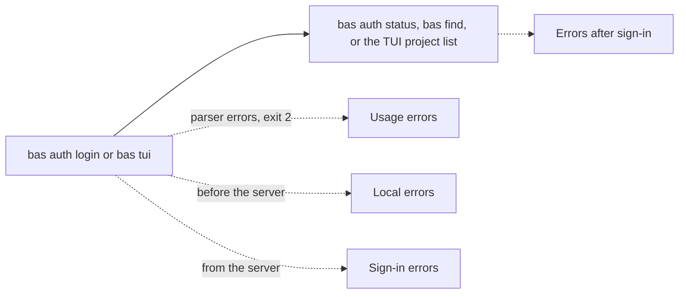

# First-run messages

The tables list every message `bas` can print between a first `bas auth login` or `bas tui` and the first secret. Each row gives the message as `bas` prints it, what the person most likely meant, and the command to type next. `NAME` stands for the profile name in the message. [Sign in with an access token](../getting-started/first-run.md) describes the first run itself.

## Usage errors from the command-line parser (exit 2)

| Message | What the user most likely meant | Exact command to type next |
|---|---|---|
| `bas` with no command prints the command list | To see what bas can do | `bas auth login` |
| `` bas: invalid arguments; rejected values are not repeated because they may be secrets. Run `bas --help` or `bas <command> --help` `` (unknown command, unknown flag, extra argument, or bad `--region` value) | A command or flag with a typo, or two profile names | `bas auth login --help` |
| `bas auth` with no subcommand prints the auth command list | To sign in | `bas auth login` |
| `error: the argument '--stdin' cannot be used with '--clipboard'` (any two of `--stdin`, `--clipboard`, `--from-env`) | One way to give the token | `bas auth login` and paste the token |
| `error: the following required arguments were not provided: --identity-url <URL>` (or `--api-url`) | A self-hosted server | `bas auth login --server-url https://your.server` |
| `error: the following required arguments were not provided: <PROFILE>` from `bas auth status` | The profile made by `bas auth login` | `bas auth status default` |
| `error: the following required arguments were not provided: --profile <PROFILE>` from `bas find` | The profile made by `bas auth login` | `bas find --profile default` |
| `error: the following required arguments were not provided: <PROFILE>` from `bas pair` | To sign in with a token | `bas auth login` |

## Errors from bas before it contacts the server

| Message | What the user most likely meant | Exact command to type next |
|---|---|---|
| `bas: that is an ID, not a profile name. A profile name is the name a profile got at sign-in, such as default. To sign in with a machine account token, run: bas auth login. To see your profiles, run: bas auth list` | A project or organization ID was typed where the profile name goes | `bas auth login` |
| `` bas: missing --relay URL, the relay of a `bas listen` on another machine. To sign in with a machine account token instead, run: bas auth login `` | To sign in with a token, not to pair | `bas auth login` |
| `bas: a profile name must be 1 to 64 lowercase letters, digits, '-' or '_', starting with a letter or digit` | A name with capitals or spaces | `bas auth login work` |
| `bas: a secret or project ID must be a hyphenated UUID` (from `--organization`) | A pasted organization ID with a typo | `bas auth login` (the organization is learned from the token) |
| `bas: choose exactly one endpoint: --region, --server-url, or both --api-url and --identity-url` | Two endpoint flags at once | `bas auth login` |
| `bas: an endpoint must be an https:// URL without credentials, query, or fragment` | An `http://` or decorated server URL | `bas auth login --server-url https://your.server` |
| `bas: an endpoint must be an absolute URL` | A host name without a scheme | `bas auth login --server-url https://your.server` |
| `bas: no terminal to paste the token into; give it with --stdin, --clipboard, or --from-env` | Sign-in from a script | `bas auth login --stdin < token-file` |
| `bas: --stdin needs piped input; typing at a terminal would echo the secret` | To paste the token | `bas auth login` |
| `bas: the secret input is empty` | Enter was pressed before the paste, or the pipe was empty | `bas auth login` and paste the token |
| `bas: the secret input is not valid UTF-8 text` | The wrong file was piped | `bas auth login` and paste the token |
| `bas: cancelled; nothing was saved` | Esc or Ctrl-C at the prompt | `bas auth login` |
| `bas: could not read the terminal` | A terminal that refuses raw mode. Copy the token first | `bas auth login --clipboard` |
| `bas: the machine token is not in Secrets Manager access-token format` | Part of the token, or another secret, was pasted. Copy the whole access token again | `bas auth login` |
| `bas: no clipboard is available here; use --stdin` | `--clipboard` over SSH or without a desktop | `bas auth login` |
| `bas: the clipboard does not contain text` | The token was not copied yet | `bas auth login` |
| `bas: could not read the clipboard; use --stdin` | A clipboard that refuses access | `bas auth login` |
| `bas: profile 'NAME' reads its token from BWS_ACCESS_TOKEN, which is not set` | `--from-env` in a shell without the variable | `bas auth login` |
| `` bas: profile 'NAME' is a remote profile; run `bas auth logout NAME` first `` | Reusing a paired profile's name for a token | `bas auth login other-name` |
| `` bas: profile 'NAME' is bound to another organization or endpoint; run `bas auth logout NAME` first `` | A token of another organization for an existing profile | `bas auth login other-name` |
| `bas: BAS_CONFIG_DIR must be an absolute path` | A relative path in the variable | `export BAS_CONFIG_DIR="$HOME/.config/bas"` |
| `bas: profile configuration must live outside a repository, but DIR is inside REPO; set BAS_CONFIG_DIR to another directory` | `BAS_CONFIG_DIR` inside a Git checkout | `export BAS_CONFIG_DIR="$HOME/.config/bas"` |
| `bas: the bas configuration directory must be a private directory accessible only to its owner` | A shared or group-readable directory | `chmod 700 "$BAS_CONFIG_DIR"` |
| `bas: no user configuration directory is available; set BAS_CONFIG_DIR` | A system without a home configuration directory | `export BAS_CONFIG_DIR=/absolute/private/dir` |
| `bas: profile configuration FILE is malformed` (also: `could not read profile configuration FILE`, `has a non-HTTPS endpoint`, `has a malformed remote or listener entry`) | A hand-edited `config.toml`. Correct the file it names | `"$EDITOR" FILE` |
| `bas: waiting for another bas process that is changing grants or profiles, or delivering a secret` | Another bas run holds the lock. Bas continues by itself when it ends | `pgrep -fl 'bas listen'` |
| `bas: could not lock the bas policy; grants and profiles were not changed` | An unwritable configuration directory | `ls -ld "$BAS_CONFIG_DIR"` |
| `bas: could not start the async runtime` | The system is out of resources | Retry `bas auth login` |

## Errors from the sign-in itself

| Message | What the user most likely meant | Exact command to type next |
|---|---|---|
| `bas: Secrets Manager refused the machine token for profile 'NAME' at https://identity.bitwarden.com and https://identity.bitwarden.eu; check that you copied the whole token, or pass --server-url for a self-hosted server` | A revoked, expired, or partly copied token, or a self-hosted server. Copy a fresh token from the web vault | `bas auth login` |
| `bas: Secrets Manager refused the machine token for profile 'NAME'` (one endpoint given or stored) | The wrong region or server for this token | `bas auth login` without `--region` |
| `bas: could not reach the identity endpoint URL for profile 'NAME'` | No network, a proxy, or a mistyped server | `curl -sI URL` |
| `bas: authentication failed for profile 'NAME'` | An unusual server answer | `bas auth login` again |
| `bas: Secrets Manager did not authenticate profile 'NAME'` | The server answered without a session | `bas auth login` again |
| `bas: the machine token for profile 'NAME' names no organization` | A token that is not a machine account access token. Create one for the machine account in the web vault | `bas auth login` |
| `bas: the machine token for profile 'NAME' belongs to organization ID, not the configured ID` | `--organization` with the wrong ID | `bas auth login` without `--organization` |
| `bas: the OS credential store is locked or denied access (DETAIL) for profile 'NAME'; headless systems can use --from-env instead` | A locked keychain (macOS) | `security unlock-keychain` |
| `bas: the OS credential store failed (DETAIL) for profile 'NAME'; headless systems can use --from-env instead` | A server without a keychain service, such as `DBus error: Failed to connect to socket`. Let your secret delivery set `BWS_ACCESS_TOKEN` in the environment | `bas auth login --from-env` |
| `bas: the OS credential store failed for profile 'NAME'; headless systems can use --from-env instead` | Another keychain error | `bas auth login` again |
| `bas: could not write profile configuration FILE` | A full or read-only disk | `df -h "$BAS_CONFIG_DIR"` |
| `authenticated profile 'NAME' for organization ID at URL; token source: os credential store`, then `` bas: next: run `bas tui --profile NAME` to browse your secrets, or `bas find --profile NAME` to list references `` | Success | `bas tui --profile NAME` |

## After sign-in, before the first secret

| Message | What the user most likely meant | Exact command to type next |
|---|---|---|
| `` bas: profile 'NAME' is not configured; run `bas auth login NAME --help` or `bas pair NAME --help` `` | A profile that was never created, or a typo. `bas auth list` shows the names. | `bas auth login NAME` |
| `` bas: no machine token is stored for profile 'NAME'; run `bas auth login NAME --help` `` | The credential-store entry was removed | `bas auth login NAME` |
| `` bas: profile 'NAME' is a remote profile; it only resolves references for `bas run` and `bas env run` through its paired listener `` | `bas find` or `bas tui` with a paired profile | `bas auth login` |
| `bas: choose a profile: bas tui --profile NAME, where NAME is one of A, B` | `bas tui` with several profiles and none named default | `bas tui --profile A` |
| `bas: bas tui needs an interactive terminal: …` | `bas tui` from a script or pipe. Open a terminal | `bas tui` |
| `bas: profile 'NAME' is not authorized to list secret identifiers` | The machine account has no project access. Grant it a project in the web vault | `bas find --profile NAME` |
| `bas: could not reach Secrets Manager at URL to list secret identifiers` | No network | `bas find --profile NAME` again |
| `bas: Secrets Manager refused to list secret identifiers for profile 'NAME' (HTTP STATUS)` | A server error | `bas auth status NAME` |
| `bas: could not list secret identifiers: the Secrets Manager response was unusable` | An unusual server answer | `bas auth status NAME` |
| `bas: no secret key matches 'QUERY'` | A key typed differently | `bas find --profile NAME` |
| TUI sign-in screen: `the machine token is not in Secrets Manager access-token format. Copy the whole access token and paste it again` | Part of the token was pasted. The field is cleared | Paste the whole token and press Enter (keys, not a command) |
| TUI sign-in screen: any sign-in error above, followed by `. Paste the token again` | As above. The screen stays open | Paste the token and press Enter (keys, not a command) |
| TUI: `could not connect to Secrets Manager: …` (the app closes) | A stored token that stopped working | `bas auth login NAME` |
| TUI: `Could not list projects: …` | The machine account has no project access. Grant it a project in the web vault | `bas tui` |
