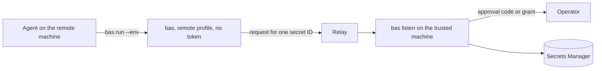
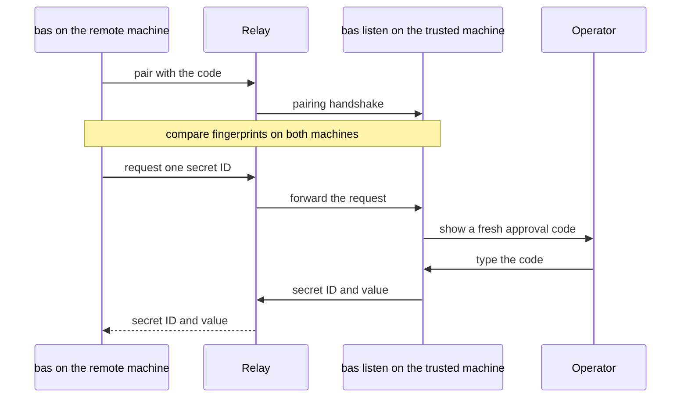

# Pair a remote machine with Agent Access

Agent Access lets `bas` on a remote machine use secrets without holding a machine token. The remote machine asks a listener on a trusted machine for each secret, and the operator of the trusted machine approves each request, or a grant approves it. Agent Access is an experimental Bitwarden protocol that sends credentials between paired machines through a relay server.



Both machines need a working OS credential store for the identity and session keys. A machine token in the environment doesn't replace the credential store.

## Choose a relay

Choose and approve a relay before you expose a listener beyond local testing. Use `wss://` for a remote relay, because `bas` accepts plain `ws://` only for loopback addresses. The `bas` project doesn't run a relay.

## Start the listener and pair

On the trusted machine, sign in with a direct profile first, as [Sign in with an access token](../getting-started/first-run.md) shows. Then start the listener with the secret IDs that remote devices may ask for, and `--pair` to accept one new device.

```sh
bas listen --profile work --relay wss://<relay-host> --allow <secret-id> --allow <secret-id> --pair --peer-name build-host
```

On the remote machine, pair with the listener. `bas pair` asks for the code that the listener shows, and then for the handshake fingerprint. Compare the fingerprints on both machines before you confirm.

```sh
bas pair remote --relay wss://<relay-host>
bas run --env "API_TOKEN=bas://remote/<secret-id>" -- your-command
```

Type the pairing code in the terminal that controls the remote program, and keep pairing material out of logs and agent transcripts.



## How the listener decides

Pairing lets a device ask for secrets, and it doesn't give the device access. By default, the operator approves each exact request by typing a fresh code that the listener shows in its terminal. `bas run` requests each reference separately, and one failed request stops the program from starting.

```text
on(request from a paired device)
  if the secret ID is outside --allow
    deny
  if the grant file is malformed
    deny
  if an active grant covers the device, profile, and secret ID
    deliver
  else if the listener has a terminal
    ask the operator to type a fresh code
  else
    deny
```

The listener accepts only explicit secret IDs within its `--allow` list. A remote profile can't find, create, or update secrets, and a remote failure never falls back to a machine token. The listener puts the secret ID in the credential ID field of the Agent Access response and the value in the password field, and it leaves the other fields empty.

## Limits of the pinned SDK

The pinned Agent Access SDK doesn't keep replay nonces across a restart, so each delivery has to pass the current checks again. A replay nonce is a one-time value that stops an old message from being accepted twice. When a session replacement handshake fails verification, the listener refuses the device and drops any queued replies for it. To recover, restart the listener or pair again.

## Remove a remote profile

`bas auth logout <profile>` removes a remote profile and its pairing from the remote machine. On the trusted machine, `bas auth logout` of the direct profile removes its paired devices and revokes its grants. Neither deletes any secret in Secrets Manager.
