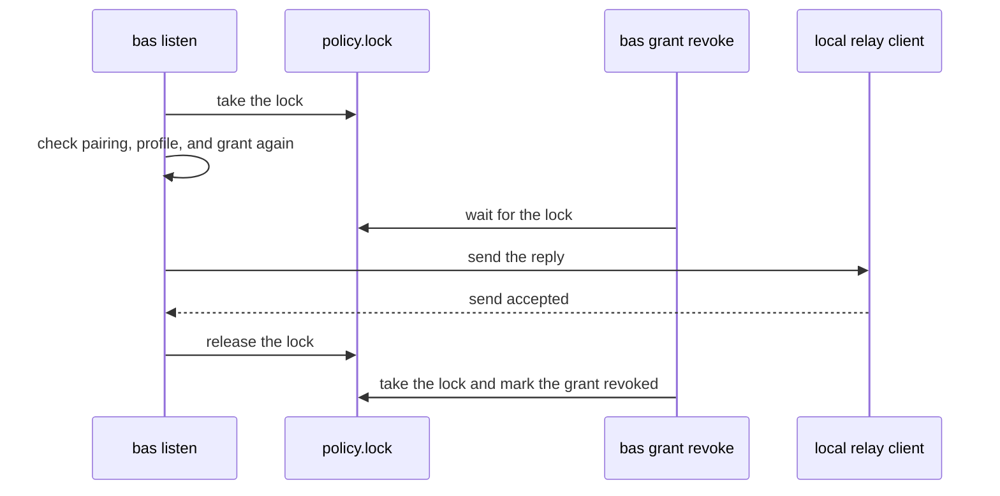

# Grants

A grant lets a listener deliver a secret to a paired device without asking the operator. You create grants only on the trusted machine. Each grant ties one paired device fingerprint to a profile, an organization, and exact secret IDs, and it stays active until you revoke it. A grant can't widen the `--allow` list of the listener.

```sh
bas auth list                                     # shows paired device fingerprints
bas grant add --profile work --device <paired-fingerprint> --secret <secret-id>
bas grant list --profile work --json
bas grant revoke <grant-id>
```

```text
grants.toml (in the bas configuration directory)
└── grant <grant-id>
    ├── state         active or revoked
    ├── device        <paired-fingerprint>
    ├── profile       work
    ├── organization  <organization-id>
    └── secrets       [<secret-id>, ...]
```

`bas grant add` prints the grant as one JSON line, and it prints an identical active grant instead of making a duplicate. Different grants that overlap stay separate, so to remove access, revoke every grant that allows it. A malformed grant file makes the listener deny every delivery.

## How revocation waits for deliveries

The listener checks the pairing, the profile, and the grant again before it releases each approved reply, and it holds a lock on `policy.lock` until the local relay client accepts the reply. `bas grant revoke` takes the same lock, so a revocation that succeeds always waits for any delivery that has already started.



The send result confirms that the local relay client accepted the reply. It doesn't confirm that the reply reached the remote machine, so a reply queued before a revocation can still arrive after it. A revocation can't erase a value the remote machine already has, so rotate the secret if a device should lose it for good.

The listener withholds a reply that stays queued past its request deadline, and it then denies the device until the listener restarts.
